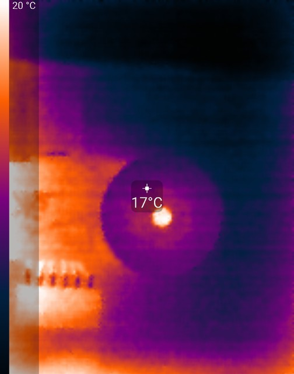
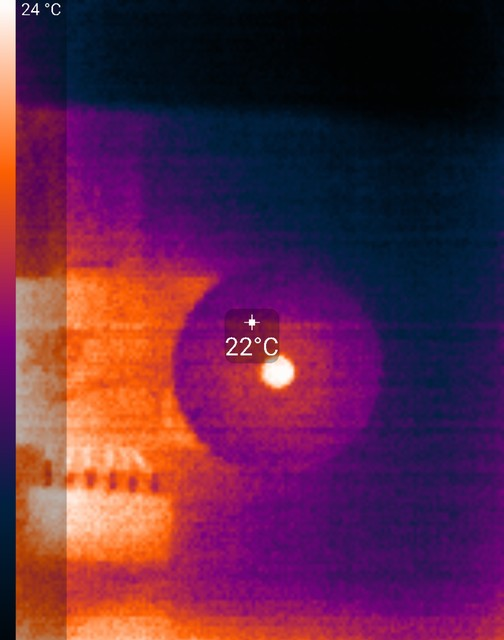
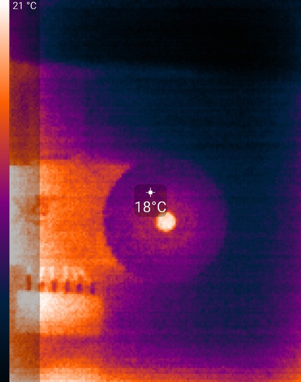
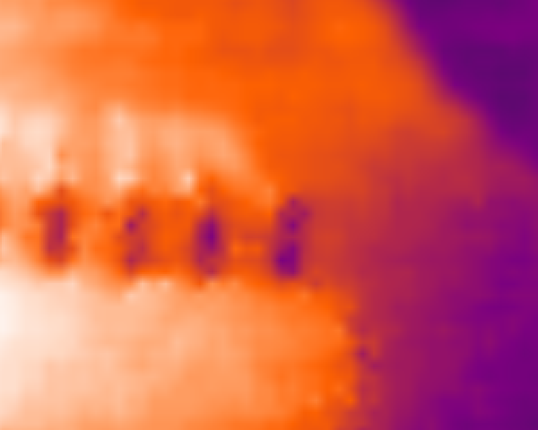
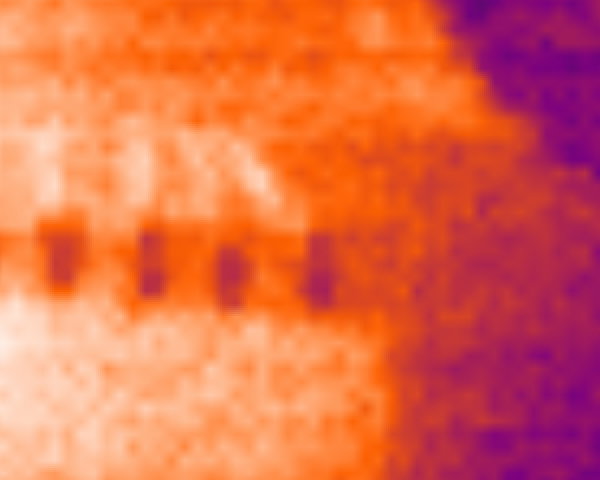
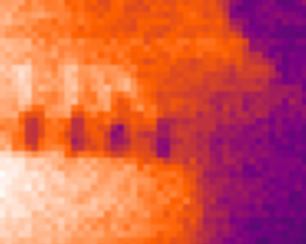
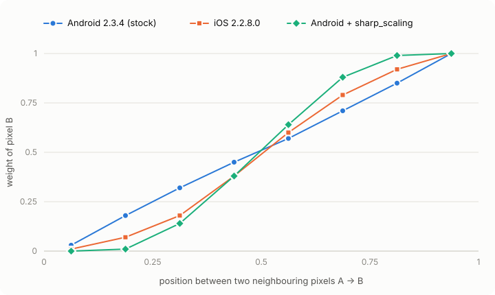

# seek-patch

Unofficial patches for the **Seek Thermal** Android app (`com.tyriansystems.SeekThermal`, 1.9.1 – 2.3.4).
Bring your own APK; get a live view that runs at the camera's real frame rate and is upscaled like
the iOS app, an "Image smoothing" switch that does what it says, lossless photos with the sensor's
own pixels beside them, videos as good as the photos, and a button that flattens the gradient of a
warm camera.

[](https://github.com/yrambler2001/seek-thermal-apk-patches/actions/workflows/ci.yml)
[](LICENSE)


| Image smoothing **off** (stock) | Image smoothing **on** (stock) | Image smoothing **on** + seek-patch |
|:---:|:---:|:---:|
|  |  |  |
|  |  |  |

<sub>Live view of the Seek Thermal app 2.3.4 on a Pixel 8 Pro, a Seek Compact looking at itself in a
mirror, Iron palette; bottom row: 2× crops with the screen pixels kept.  Each shot auto-ranges
its own colour span.</sub>

## What it fixes

| | stock app | with seek-patch | patch |
|---|---|---|---|
| **Frame rate** | **15 fps** on screen: the live view redraws only when the phone's *own rear camera* delivers a frame, and the app runs that camera at 15 fps | **~28 fps**, every thermal frame (the Compact sends ~30) | `full_fps` |
| **Upscaling** | plain bilinear: each sensor pixel is smeared across its whole width | iOS-style: each pixel stays sharp, blending only across the middle half | `sharp_scaling` |
| **"Image smoothing" switch** | *off* is the smoother picture: it adds a 3×3 blur, and the temporal smoothing stays on either way | *off* turns temporal and spatial smoothing off | `no_smoothing` |
| **Photos** | JPEG, quality 100 but 4:2:0 colour; the PNG setting is hidden | lossless PNG (the app's own *Save Uncompressed*, turned on) | `png_photos` |
| **Sensor pixels** | only the 1280×960 upscaled photo | also the frame at the sensor's resolution, PNG, no overlays, in `Pictures/Seek Thermal 1x/` | `photo_1x` |
| **Video** | H.264 480×640 at a fixed 1.5 Mbit/s, **15 fps** (the phone camera's clock), mono 44.1 kHz 64 kbit/s sound | HEVC **960×1280** at constant quality (~50 dB PSNR), **every thermal frame**, stereo 48 kHz 256 kbit/s | `video_quality` |
| **Microphone** | Android 11+: photos, videos and the gallery all ask for the microphone and drop the tap; after two denials none of them starts again | only starting a video asks, and the video then starts by itself; when Android won't ask again, a dialog offers the settings page or recording without sound | `mic_prompt` |
| **Warm camera** | once the camera has warmed unevenly, every picture has a gradient (bright edges, dark middle), even of a uniform wall | a **Flat field** button: point at a uniform surface, tap, and the gradient is gone (14 °F across a wall → under 1 °F) | `flat_field` |
| **Noise** | the temporal smoothing blends only pixels that did not change: little effect on a hand-held camera, trails when it does act | a **Smart smoothing** button (off by default): a filter that follows the camera's motion and averages up to 8 frames per pixel, plus stripe and left-edge correction; about half the grain on hand-held scenes, no ghosting on faces | `smart_smoothing` |
| **Returning from a dialog** | the app crashes (`glError 0x506`) after Android's permission dialog | the live view comes back | `resume_fix` |
| **Diagnostics** | the SDK's USB / frame-timing log is compiled out | `adb logcat -s Seekware` | `debug_log` (opt-in) |

Nothing else changes: the same app and the same calibration.  The patches never touch USB or the
camera firmware.

## Quick start

You need Python 3.9+, a Java runtime (JDK 11 or newer) and, to install from the computer, `adb`.

```sh
pipx install git+https://github.com/yrambler2001/seek-thermal-apk-patches      # or: pip install .  from a checkout
seek-patch doctor                                         # checks Java, fetches the pinned tools
seek-patch patch Seek+Thermal_2.3.4.apk                   # -> Seek+Thermal_2.3.4-patched.apk
```

The default set adapts to the version: a patch that does not apply to your APK is skipped and named
in the output.  `seek-patch check APK` shows the details first.

The patched app is signed with **your** key (created on first run), the store app with Seek's, so
Android will not install one over the other.  Either replace it:

```sh
adb uninstall com.tyriansystems.SeekThermal               # resets the app's settings; saved photos stay
adb install Seek+Thermal_2.3.4-patched.apk
```

or keep both, with the patched one as a separate app called "Seek (patched)":

```sh
seek-patch patch Seek+Thermal_2.3.4.apk --side-by-side --install
```

**Getting the APK** – seek-patch takes one complete ("universal") `.apk`, or a split bundle:
`.xapk` (APKPure), `.apks`, or `.apkm` (APKMirror, unless encrypted).  A bundle is first merged into
one apk with [APKEditor](https://github.com/REAndroid/APKEditor), fetched on first use.  The merged
app has the native code of the ABIs the bundle includes; APKPure's `.xapk` of the Seek app has only
`arm64-v8a`, which every recent phone runs.

To start from the app on your phone, run `adb shell pm path com.tyriansystems.SeekThermal`.  If it
prints a single path, `adb pull` it (drop the `package:` prefix).  If it lists a `base.apk` plus
`split_config.*.apk` files (a split install from the Play Store), pull them all into an empty folder
and zip them into one bundle: `zip seek.apks *.apk`.  The base alone is refused, because its native
code is in a split.  `seek-patch check FILE` tells you whether a file is usable.

## Usage

```
seek-patch list                         the patches, their tested versions, the default set
seek-patch check APP.apk                dry run: which patches apply to this apk, and why not
seek-patch patch APP.apk [options]      patch, rebuild, align, sign
seek-patch doctor                       Java, the pinned apktool + uber-apk-signer + APKEditor, your signing key
```

`APP.apk` can also be a split bundle (`.xapk`, `.apks`, `.apkm`); the result is always one `.apk`.

| `patch` option | |
|---|---|
| *(none)* | the default set — every patch but `debug_log` — skipping those that do not apply to this version |
| `-p NAME` | pick patches yourself (repeatable), e.g. `-p full_fps -p debug_log`; each must apply |
| `--all` | every patch, `debug_log` included; each must apply |
| `--sharpness N` | `sharp_scaling`'s blend width, 1/N of a pixel: `2` = iOS (default), `3`–`4` crisper, larger approaches visible pixels |
| `--video-codec hevc\|avc` | `video_quality`'s codec: HEVC (default; H.264 is the automatic fallback) or H.264 first, for players without HEVC |
| `--video-qp N` | `video_quality`'s constant quantizer, 10 – 40: lower is better and bigger; `18` (default) ≈ 68 MB/min on a still scene |
| `--side-by-side` | new package name (`<original>.patched`) and label, so it installs next to the store app; `--package`, `--label` to choose them |
| `--install` | `adb install -r` the result |
| `-o FILE`, `-f` | output file (default `<input>-patched.apk`), overwrite it |

`python -m seekpatch` works as well as the `seek-patch` command.

## Results

Measured on a Pixel 8 Pro (Android 16) with a Seek Compact (firmware 1.3.0.0) — see
[docs/measuring.md](docs/measuring.md) to repeat any of it.

| live view | stock 2.3.4 | patched |
|---|---|---|
| frames from the camera | ~30 fps | ~30 fps |
| frames on screen (SurfaceFlinger) | **14.9 fps** | **27.5 fps** (the rest: shutter frames, and the panel dropping to 30 Hz) |
| render-thread CPU | 11 % of a core | 11 % of a core (the scaling runs in the shader) |

| recording | stock 2.3.4 | patched (defaults) |
|---|---|---|
| video | H.264 High, 480×640, 1.5 Mbit/s | HEVC Main (hardware), 960×1280, QP 18: ~9 – 10 Mbit/s on a still scene |
| frame rate | 15.0 fps | 24.6 – 27.7 fps: every thermal frame, pausing only for the shutter |
| quality vs a near-lossless recording | – | 51.6 dB PSNR, SSIM 0.992, 99.6 % of the sensor noise kept |
| sound | AAC mono 44.1 kHz, 64 kbit/s | AAC stereo 48 kHz, 250 kbit/s |
| photo | JPEG q100, 4:2:0 | PNG, plus a 156×206 PNG of the sensor frame |

<picture>
  <source media="(prefers-color-scheme: dark)" srcset="docs/images/kernel-dark.svg">
  
</picture>

How much of the next pixel each display pixel shows, by position — measured from live-view
screenshots (Android) and a saved photo (iOS 2.2.8.0, same camera model and firmware).  Stock
Android is a straight bilinear ramp; iOS holds each pixel for the first and last quarter and blends
across the middle half; `sharp_scaling` reproduces that.  The numbers are in
[docs/sharp-scaling.md](docs/sharp-scaling.md).

## Supported versions

Every release listed in [docs/versions.md](docs/versions.md) (1.9.1 – 2.3.4) was decoded,
patched, rebuilt and signed in testing; 2.3.4 was also run on a phone (Pixel 8 Pro).

| patch | versions | |
|---|---|---|
| `full_fps` | 1.9.1 – 2.3.4 | |
| `sharp_scaling` | 2.0 – 2.3.4 | 1.9.x saves photos differently |
| `no_smoothing` | 2.2.0 – 2.3.4 | the feature ids are verified in the image library these versions ship; it refuses older ones |
| `png_photos` | 2.1.2 – 2.3.4 | Android 11+ (older Android cannot write EXIF into a PNG; it keeps the setting) |
| `photo_1x` | 2.1.1 – 2.3.4 | |
| `video_quality` | 2.1.2 – 2.3.4 | |
| `resume_fix` | 1.9.1 – 2.3.4 | |
| `mic_prompt` | 2.3.1 – 2.3.4 | older releases ask for the microphone with storage and never block on it |
| `flat_field` | 2.2.0 – 2.3.4 | the gradient features are verified in the image library these versions ship; it refuses older ones |
| `smart_smoothing` | 2.2.3 – 2.3.4 | arm64-v8a and armeabi-v7a; older image libraries call the filter directly, so there is nothing to hook |
| `debug_log` | 2.0 – 2.3.4 | 1.9.x has no frame-timing log |

`seek-patch check` tells you for your file, and suggests the command to use.

## How it works

The app is decoded to smali with apktool, edited, rebuilt and signed.  The code is obfuscated
differently in every release, so the patches never use class names: they find code by what it does —
the GL thread that names itself `ThermalPlusRenderThread`, the method that uploads a `ByteBuffer`
with `glTexImage2D`, the shader that samples `thermalTexture` — and refuse, changing nothing, when
the shape is not what they expect.  A split bundle is merged into one apk first, by APKEditor, which
also drops the manifest attributes that make Android require the splits.

- [`full_fps`](docs/full-fps.md) — moves the redraw from the phone-camera callback to the thermal upload.
- [`sharp_scaling`](docs/sharp-scaling.md) — a "sharp bilinear" remap in the thermal fragment shader; photos get the same kernel on the CPU.
- [`no_smoothing`](docs/smoothing-switch.md) — after the app sends the smoothing preset, clears the temporal and spatial filter stages when the switch is off.
- [`png_photos`](docs/png-photos.md) — turns on the app's hidden *Save Uncompressed* setting.
- [`photo_1x`](docs/photo-1x.md) — keeps the photo method's sensor-sized frame and writes it once the photo is saved.
- [`video_quality`](docs/video-quality.md) — picks and configures the encoder, hands it every thermal frame, records 48 kHz stereo.  How the QP was chosen is in there.
- [`mic_prompt`](docs/mic-prompt.md) — routes the app's microphone check and request through a small helper, and starts the video once the camera runs again.
- [`flat_field`](docs/flat-field.md) — adds the button; a tap has the library's gradient stage learn its correction map from the next 40 frames, which it otherwise does only for frames that already look flat.
- [`smart_smoothing`](docs/smart-smoothing.md) — adds the button and a small native library of seek-patch's own: it hooks the image library's first filter, which then runs without its temporal smoothing, and filters its output in place.
- [`resume_fix`](docs/resume-fix.md) — destroys the live view's EGL surface before the app drops it on pause.
- [`debug_log`](docs/debug-log.md) — gives the SDK's stripped log methods a body.

Patches that need more than a few instructions add helper classes written in Java
([`helpers/java`](helpers/java)) and compiled to smali, which is committed: patching needs no Android
SDK.  `smart_smoothing`'s native library ([`helpers/native`](helpers/native)) is committed too, built
reproducibly with the NDK.  By default only the code is decoded (`apktool -r`): resources and the binary manifest are
carried over byte for byte, so a rebuild cannot break them.  `--side-by-side` decodes resources too,
to rename the package.

## FAQ

**What are temporal and spatial smoothing?**  The two noise filters in the camera's image library
(libseekip).  They run before the colours are applied, so they shape the temperature readings as
well as the picture.

- *Temporal* smoothing (`alpf`) averages each pixel over time.  It compares the pixel with its
  previous output.  A difference *d* below a threshold *T*, set from the camera's factory
  sensitivity, shows only a fraction *d/T* of itself: noise barely gets through, while a change of
  *T* or more shows at once.  The result becomes the history for the next frame, so a small real
  change creeps in over several frames.  The picture is calm, but faint moving warm things leave
  trails and small temperature changes show late.
- *Spatial* smoothing (`aslpf`) averages each pixel with its neighbours, one frame at a time.  Every
  pixel becomes the mean of its 3 × 3 neighbourhood unless strong slopes around it mark an edge.
  Noise in flat areas drops by up to 3×, but detail too faint to count as an edge is blurred: fine
  texture, thin wires.  The edge test compares only the top-right side of a pixel with the
  bottom-left side, so an edge running exactly from bottom-left to top-right is not seen, and it
  is blurred too.

| | temporal | spatial | detail kept |
|---|---|---|---|
| stock, "Image smoothing" on | on | off | 14.1 % |
| stock, "Image smoothing" off | on | **on** | 10.6 % |
| `no_smoothing`, switch off | off | off | 15.3 % |

That is why stock *off* looks softer than *on*: it adds the spatial blur and keeps the temporal
one.  *Detail kept* is the per-pixel structure left in the sensor frame, measured as in
[docs/smoothing-switch.md](docs/smoothing-switch.md).

**Are temperatures affected?**  `full_fps`, `sharp_scaling` and the photo and video patches only
change when and how the image is drawn and saved.  `no_smoothing` turns off the library's temporal
and spatial filters, and the temperature readout is computed from the filtered frame — so with the
switch off, spot readings fluctuate frame to frame like the image does, instead of being averaged.
`flat_field` changes readings only when you tap it: the correction it learns applies to the
temperatures as well as the picture.  The camera's own gradient leaves the readings, and the centre
of the image keeps its value.  `smart_smoothing`, when on, filters the frame the temperatures are
computed from: spot readings get steadier (the noise averaged over up to 8 aligned frames instead
of the stock temporal filter), and small changes take 8–12 frames to settle fully.  The calibration is untouched.  For per-pixel temperatures, the app's own *Store All Thermal Data*
setting saves a radiometric TIFF with each photo.

**How big are the videos?**  About 68 MB a minute at the default QP on a still scene, more when the
camera moves; `--video-qp 20` is ~55 MB, `24` ~30 MB (see the table in
[docs/video-quality.md](docs/video-quality.md)).  Choose `--video-codec avc` if something you play
them on lacks HEVC; it costs ~20 % more.

**Why no 4:4:4 video?**  No encoder on the phone supports it.  At 960×1280, 4:2:0 still stores colour
at three times the Compact sensor's resolution, so no sensor pixel loses its colour.

**Will the app update itself?**  No: the Play Store will not update an app signed with another key.
Patch the new version when there is one.

**Smart smoothing or the "Image smoothing" switch?**  They are independent.  The switch picks the
library's preset (with `no_smoothing`, *off* is no temporal or spatial filter); *Smart smoothing on*
replaces only the temporal filter with seek-patch's.  The spatial 3×3 blur still follows the switch:
for the most detail, keep the switch on (or off with `no_smoothing`) and Smart smoothing on.

**Thermal+?**  Not tested on a phone yet.  By design it keeps working: the phone-camera callback still
latches the camera image Thermal+ blends in, and the video encoder draws the same scene as the
screen.

**Which GPUs?**  The shader is plain OpenGL ES 2.0, written for any Android GPU; it has been run on
the Pixel 8 Pro's Mali.  GPUs without high-precision fragment shaders (old Mali-400 / 450, early
Tegra) keep the stock bilinear scaling instead of showing artifacts.

## Legal

Not affiliated with, endorsed by or supported by Seek Thermal, Inc.  "Seek Thermal" is their
trademark, used here only to say which app this works with.  This repository contains no Seek code
and no APKs: the patches are applied locally, to an APK you supply, for your own use.  Use at your
own risk.

## Development

```sh
pip install -e '.[dev]'
pytest                     # unit tests on synthetic smali (tests/fixtures), no APK needed
SEEK_APK_DIR=~/apks SEEK_BUILD=1 pytest tests/test_real_apks.py    # against your own apks
python3 helpers/build.py   # after changing a Java helper (needs the Android SDK)
python3 helpers/build_native.py   # after changing helpers/native (needs the NDK r25b)
SEEK_SUPERRES=~/superres pytest tests/test_native.py   # the hook against the research stage on a burst
```

Adding a patch: [docs/writing-patches.md](docs/writing-patches.md).  The tools in `tools/` measure
frame rate, upscaling kernels and the phone's video encoders ([docs/measuring.md](docs/measuring.md)).

## License

[MIT](LICENSE).  apktool, uber-apk-signer and APKEditor (Apache-2.0) are downloaded on first use, not
bundled.
