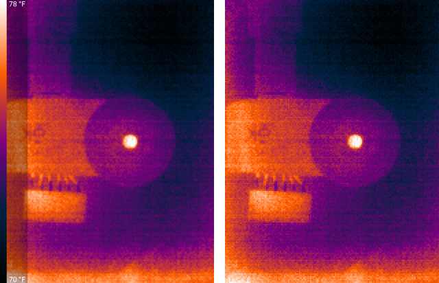

# `photo_1x` — the sensor's own pixels, next to every photo

**Stock:** a photo is the colorized frame scaled up to 1280×960, with the overlays (palette bar,
temperatures, spot marker) drawn on top.
**Patched:** the same photo, plus the frame at the sensor's resolution — 206×156 on a Compact,
320×240 on a Compact Pro — as a lossless PNG without overlays, turned upright.

| `Pictures/Seek Thermal/img_thermal_1792780046753.png` | `Pictures/Seek Thermal 1x/img_thermal_1792780046753.png` |
|---|---|
| 1280×960 (EXIF: rotate 90°), overlays, ~0.6 MB | 156×206, no overlays, ~60 KB |

Left: the photo (with `png_photos` and `sharp_scaling`).  Right: the 1× copy, each sensor pixel
drawn as a block.  Seek Compact, Iron palette.

It goes into a **sibling folder** named after the photo folder plus " 1x", under the photo's own
name: Seek's in-app gallery lists every file under the photo folder whose name contains "thermal",
so a copy next to the photo would show up there twice.  Google Photos and other galleries see the
folder as an album.  Deleting a photo in Seek's gallery does not delete its 1× copy.

## How

The photo method receives the frame as a sensor-sized `Bitmap` before it draws it, scaled, into the
photo canvas.  The patch hands that bitmap and the camera's `Context` to `seekpatch.Photo1x` at the
start of the method, and when the method that writes the EXIF tags and copies the file to its final
name returns, `Photo1x.saved(final file, orientation)` writes the PNG.  The orientation is the
value the app puts in the photo's EXIF; the PNG's pixels are rotated to match, because PNG viewers
ignore EXIF orientation.

Thermal+ photos store the thermal frame.  In 16:9 mode the photo is cropped; the 1× copy keeps the
whole frame.

Versions: 2.1.1 and newer.  Source: [`helpers/java/seekpatch/Photo1x.java`](../helpers/java/seekpatch/Photo1x.java).
