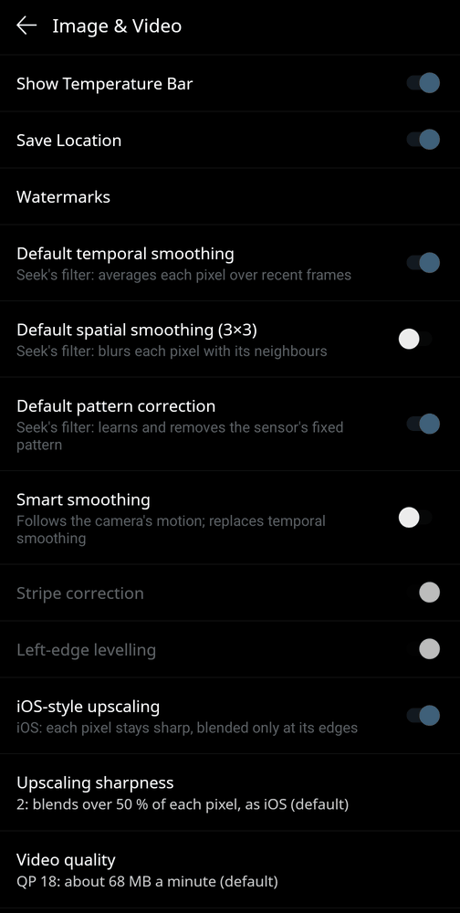

# `smoothing_settings` — a switch for each of Seek's filters

**Stock:** *Settings → Image & Video* has one *Image smoothing* switch.  It picks between two
presets of the image library's filters, and *off* is the smoother picture (see
[smoothing-switch.md](smoothing-switch.md)).
**Patched:** in its place, one switch per filter:

| switch | default | what it does |
|---|---|---|
| **Default temporal smoothing** | on | Seek's filter (`alpf`): averages each pixel over recent frames |
| **Default spatial smoothing (3×3)** | off | Seek's filter (`aslpf`): blurs each pixel with its neighbours |
| **Default pattern correction** | on | Seek's filter (`sbnuc`): learns and removes the sensor's fixed pattern |
| **Smart smoothing** | off | seek-patch's filter: follows the camera's motion; replaces temporal smoothing |
| **Stripe correction** | on | Smart smoothing's column-stripe correction |
| **Left-edge levelling** | on | Smart smoothing's levelling of the strip at the screen's left edge |



"Default" marks Seek's own algorithms.  The defaults are the stock app with *Image smoothing* on, so
nothing changes until a switch is touched.  The last three appear only when
[`smart_smoothing`](smart-smoothing.md) is in the app too (2.2.3 – 2.3.4).  *Default temporal
smoothing* is greyed out while Smart smoothing is on, because Smart smoothing replaces it; *Stripe
correction* and *Left-edge levelling* are greyed out while it is off.  The *Smart smoothing* switch
and the button at the top left of the camera screen are one setting: either moves the other.
Changes apply from the next frame.  The old *Image smoothing* switch is hidden.  The screenshot also
shows the settings of [`sharp_scaling`](sharp-scaling.md#settings) and
[`video_quality`](video-quality.md#setting).

## What the library does with "Image smoothing"

Before every frame the app sends feature 900 with the switch's value.  In the image library
(libseekip, `seekip_setfeature` case 900) that value only chooses the first filter's stage mask:

| 900 | mask | stages |
|---|---|---|
| 1 (on) | `0x86` | sbnuc `0x2` + alpf `0x4` + gradient `0x80` |
| 0 (off) | `0x1C4` (`0xC4` on 1401 sensors) | alpf + peak limiting `0x40` + gradient + aslpf `0x100` |

The value is also stored, but only read back by the matching *get* call.  The rest of case 900
does the same in both positions: per-model defaults for some OEM cores (filter and gradient-stage
features, a different mask for the 2179 / 2497X families), and for mosaic cores it moves the
gradient stage to the second filter.  On the Compact the mask read back is exactly `0x86`: none of
those applies to it.

The first filter runs before the temperatures are computed: raw frame → first filter → spot, min
and max temperatures → second filter → colours.  So every one of these switches changes the
readings as well as the picture.  Temporal smoothing makes spot readings steadier and slower,
spatial smoothing averages each reading with its neighbours, and pattern correction removes the
sensor's fixed pattern from both.

## The patch

Right after the app's feature-900 call, `seekpatch.Filters.frame(handle, sent)`:

1. makes the *on* preset the base: if the app sent 0 (the hidden switch may still be off, from an
   older seek-patch build or from before), it sends 900 = 1 again;
2. sends a stage feature for each switch that is away from its default:

| switch away from its default | feature | mask bit |
|---|---|---|
| temporal smoothing off | 102 = 0 | clears `0x004` |
| spatial smoothing on | 100 = 1 | sets `0x100` |
| pattern correction off | 106 = 0 | clears `0x002` |

At the defaults nothing is sent, and the mask is stock `0x86`.  The result does not depend on the
hidden switch.  The features go through the app's own `seekIPsetFeature`, with buffers allocated
once.  When the combination changes, or a new camera connection starts, the helper reads the mask
back (feature 132) and logs it:

```
$ adb logcat -s seek-patch
smoothing_settings: first-filter mask 0x86: temporal on, spatial off, pattern correction on
smoothing_settings: first-filter mask 0x82: temporal off, spatial off, pattern correction on
smoothing_settings: first-filter mask 0x184: temporal on, spatial on, pattern correction off
```

While Smart smoothing is on, the mask still shows `alpf`.  Smart smoothing's hook clears it from
the first filter's flags at the moment of the call (see [smart-smoothing.md](smart-smoothing.md)),
and the log line says so.

Peak limiting, the remaining stage of the old *off* preset, gets no switch: the *on* base does not
run it.

### The settings screen

The Image & Video fragment is found by behaviour: the one `PreferenceFragment` that names
`"use_smoothing"` (it logs the switch's changes) and inflates its preferences in `onCreate`.  Right
after its `addPreferencesFromResource`, `seekpatch.Settings.screen` hides the old switch and appends
the new ones.  The old switch is the last item of the screen in every release, so they take its
place.  They are instances of the app's own switch class, the old switch's class, so they look like
the rest of the screen.  Titles and summaries are English strings in the code.  No resource is read
or added, so this works with `apktool d -r` (the default) as well as with `--side-by-side`.

The values live in a preferences file of seek-patch's own (`seekpatch`), not in the app's settings:

| key | default |
|---|---|
| `temporal_smoothing`, `spatial_smoothing`, `pattern_correction` | on, off, on |
| `smart_smoothing`, `smart_stripes`, `smart_left_edge` | off, on, on (`smart_smoothing`'s own keys) |

`seekpatch.Settings.attach`, in the camera screen's `onCreate`, loads them before the first frame
and follows every change with a listener.  The per-frame code reads cached values; it never reads
the file.

The same two hooks carry the settings of [`sharp_scaling`](sharp-scaling.md) and
[`video_quality`](video-quality.md); the first of those patches to be applied adds them
(`patches/settings.py`).

### The old switch elsewhere

The *Image smoothing* switch also appears as an item of a legacy `ImagePreference`, in
`res/xml/pref_settings.xml`.  In 2.2.0 – 2.2.2 only a `SettingsActivity` loads that file, and
nothing starts that activity: it is declared but not exported, and no code names it.  From 2.2.3
on, nothing loads the file at all.  The item is never on screen, so the patch leaves it alone.

## `no_smoothing`, the alternative

[`no_smoothing`](smoothing-switch.md) keeps the single switch and makes *off* turn temporal and
spatial smoothing off.  It is no longer in the default set; pick it with `-p no_smoothing` instead of
`smoothing_settings`.  The two refuse to be combined, and `--all` leaves `no_smoothing` out.

## Versions

2.2.0 – 2.3.4, the releases whose image library has been checked to handle feature 900 and the stage
features this way (libseekip 2.10.5.0 in 2.2.2, 2.11.3.2 in 2.2.3 – 2.3.4; 2.2.0 and 2.2.1 carry
the same preset code), as for `no_smoothing`.  The settings fragment exists in this shape from 2.0
on.  The Smart smoothing switches need `smart_smoothing`, which starts at 2.2.3.

Run on a Pixel 8 Pro with a Seek Compact, app 2.3.4 side by side: the switches, their defaults and
greying, the hidden old switch, the button following the switch and back, the values after a
restart, and the logged mask of each combination.  The live view stayed at 25–26 fps with each one
(`tools/fps.sh`).
