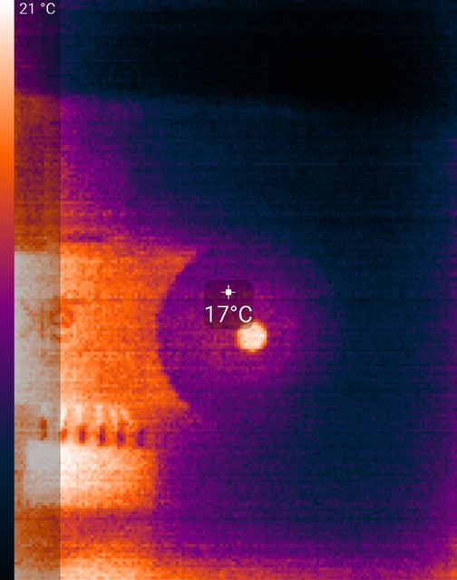
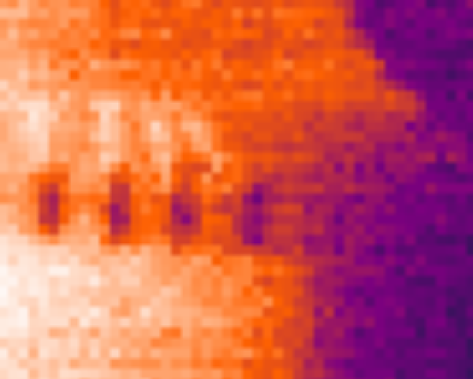

# `no_smoothing` — make "Image smoothing: off" turn smoothing off

**Stock:** switching *Settings → Image & Video → Image smoothing* **off** gives the *smoother* picture.
**Patched:** off really is unsmoothed; on is unchanged.

> Not in the default set any more: [`smoothing_settings`](smoothing-settings.md) replaces the switch
> with one switch per filter.  `no_smoothing` is the alternative that keeps the single switch; pick
> it with `-p no_smoothing` (the two cannot be combined, and `--all` leaves this one out).

| smoothing off (stock) | smoothing on (stock) | smoothing off + `no_smoothing` |
|:---:|:---:|:---:|
|  |  |  |
|  |  |  |
| detail 10.6 % | detail 14.1 % | detail 15.3 % |

Live view and 2× crops; the patched shot also has `sharp_scaling`.  "Detail" is the per-pixel
structure left in the recovered sensor frame (standard deviation of the frame minus a 1-pixel blur),
relative to the scene's contrast — see [measuring.md](measuring.md).  Scaling does not change it
(on + `sharp_scaling` measures 13.4 %); filtering does.

## Why

Before every frame the app sends library feature **900** with the switch's value.  The image library
(libseekip) turns feature 900 into a preset of filter stages (`seekip_setfeature`, case 900):

| switch | 900 | filter mask | stages |
|---|---|---|---|
| on | 1 | `0x86` | sbnuc (scene-based non-uniformity correction) + alpf + gradient |
| off | 0 | `0x1C4` (`0xC4` on 1401 sensors) | alpf + peaklimit + gradient + **aslpf** |

- **alpf** (bit `0x004`) is a temporal filter — it pulls every pixel toward its value in the
  previous frame.  It runs in *both* positions.
- **aslpf** (bit `0x100`) is a spatial 3×3 low-pass.  Only *off* runs it.

So "off" swaps the fixed-pattern correction for a blur.  Seek's iOS app has the same mapping.  The
rest of case 900 (per-model defaults) is the same in both positions; see
[smoothing-settings.md](smoothing-settings.md).

## The patch

Right after the app sends feature 900, when the switch is off, it also sends

| feature | value | clears |
|---|---|---|
| 102 | 0 | bit `0x004`, alpf (temporal) |
| 100 | 0 | bit `0x100`, aslpf (spatial) |

through the app's own `seekIPsetFeature` wrapper, with the same 4-byte little-endian buffer the app
uses.  The *on* position keeps the stock preset; the rest of the *off* preset (gradient, peaklimit)
stays.

## Temperatures

The temperature readout is computed from the output of the same filter stage.  With the switch off
and the patch in, spot / min / max readings are no longer averaged over frames, so they fluctuate
frame to frame the way the image does.  The calibration and the conversion are untouched.

## Versions

Feature ids 100 / 102 / 900 and the masks above are verified in the two libseekip versions that
have been analysed: **2.10.5.0** (app 2.2.2) and **2.11.3.2** (apps 2.2.3, 2.3.0 and 2.3.4).
Apps 2.2.0 and 2.2.1 ship a library with the same preset constants.  2.1.x ships an older library
whose feature 900 is different, so the patch refuses apps older than 2.2.0 (versionCode 260).

Up to 2.3.0 the app passes the switch as `flag ? 1 : 0`, compiled to a small branch; 2.3.4 passes the
boolean directly.  Both shapes are matched.
